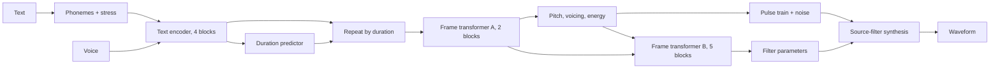

# tiny-voca

tiny-voca is a small English text-to-speech model with two voices, F2 (female)
and M2 (male). The complete model, including the waveform generator, has 4.5M
parameters and is trained from scratch on about 18 hours of synthetic speech.
It runs about 70x faster than real time on four CPU threads.

- Weights and ONNX export: https://huggingface.co/n4ze3m/tiny-voca
- Dataset: https://huggingface.co/datasets/n4ze3m/tiny-voca
- Phonemizer: https://github.com/n4ze3m/dizione

| | |
|---|---|
| Parameters | 4,537,291 (18.2 MB, float32) |
| Voices | F2, M2 (American English) |
| Output | 24 kHz mono |
| Input | Text, converted to phonemes with the dizione phonemizer |
| Speed | about 70x real time, 4 CPU threads, PyTorch or ONNX Runtime |
| Pretrained weights in the model | None |
| License | Apache-2.0 (code and weights), CC BY 4.0 (dataset) |

## Usage

Requirements: Python 3.10 or later and PyTorch 2.4 or later. The weights and
the phonemizer data are in the Hugging Face repository.

```bash
pip install -e ".[own]"
hf download n4ze3m/tiny-voca --local-dir weights
export DIZIONE_DATA=weights/phonemizer

python -m tiny_voca.infer \
  --checkpoint weights/tiny-voca.pt \
  --voice F2 \
  --text "Hello! This is tiny voca." \
  --output hello.wav
```

Options:

| Option | Default | Meaning |
|---|---|---|
| `--voice` | `F2` | `F2` or `M2` |
| `--speed` | 1.0 | Speaking rate. 0.97 matches the pace of the recordings. |
| `--pitch-shift` | 0 | Added to log F0. 0.058 is about one semitone. |
| `--pitch-range` | 1.0 | Scales pitch movement around the utterance mean. |
| `--device` | `cpu` | Any PyTorch device |

The model synthesizes one utterance at a time. Split long text into sentences
before calling it.

### ONNX

```bash
python -m tiny_voca.export --checkpoint inference.pt --output tiny-voca.onnx
```

This writes `tiny-voca.onnx` (21 MB) and `tiny-voca.json`, which lists the
phoneme symbols, voices and sample rate. The graph takes phoneme ids and stress
values and returns the waveform; text is converted to ids outside the graph.

```python
import numpy as np, onnxruntime as ort
from tiny_voca.text import phonemize, set_frontend

set_frontend("own")
phones = phonemize("Hello! This is tiny voca.")
one = lambda value: np.array([value], dtype=np.float32)
session = ort.InferenceSession("tiny-voca.onnx")
audio, durations = session.run(None, {
    "tokens": np.array([phones.ids]), "stress": np.array([phones.stress]),
    "voice": np.array([0]),            # 0 = F2, 1 = M2
    "speed": one(1.0), "pitch_shift": one(0.0), "pitch_range": one(1.0)})
```

The file also runs in onnxruntime-web (WebAssembly). The audio matches the
PyTorch model to within 0.6% of the peak amplitude, apart from the random
noise signal, which each runtime draws itself.

## Model



The text encoder and the two frame-level transformers use pre-norm blocks with
rotary position embeddings (192 channels, 4 heads). Durations, pitch, voicing
and energy are predicted explicitly, as in FastSpeech 2.

The waveform is produced by a source-filter synthesizer instead of a neural
vocoder. A band-limited pulse train at the predicted pitch and a noise signal
are each shaped by a time-varying filter, whose cepstrum the network predicts
once per frame (hop 256 samples, 10.7 ms). The oscillator provides the
periodicity, so the network only has to predict slowly varying envelopes. This
part has 25,862 parameters.

| Component | Parameters |
|---|---:|
| Embeddings (phoneme, stress, voice) | 16,704 |
| Text encoder | 1,588,864 |
| Duration and pause predictor | 123,906 |
| Frame transformer A, prosody head | 795,971 |
| Frame transformer B | 1,985,984 |
| Source-filter waveform head | 25,862 |
| Total at inference | 4,537,291 |

Two modules exist only during training: an auxiliary mel head (15,440
parameters) and the waveform discriminators (2,675,312).

## Data

The training audio is synthetic. Both voices were created from text
descriptions with Qwen3-TTS VoiceDesign, and all recordings were generated with
Qwen3-TTS 1.7B Base using those two reference clips. No recording of a real
speaker is involved. Each clip was screened with Whisper small.en and rejected
above 15% word error rate.

| Split | Clips | Hours |
|---|---:|---:|
| Train | 16,018 | 17.6 |
| Validation | 714 | |
| Test | 594 | |

The dataset has 17,371 clips (19.1 hours) in two batches. The first batch
reads LibriTTS-R transcripts (CC BY 4.0) and sentences written for this project
with an LLM. The second batch, training data only, reads Mozilla Common Voice
sentences (CC0) and project templates covering numbers, dates, money, names and
questions. Every row keeps its source, license and generation settings.

Phoneme durations come from forced alignment with
`facebook/wav2vec2-lv-60-espeak-cv-ft`. The aligner is used only to label the
training data. 17,326 of 17,371 recordings passed the alignment checks; the
table counts those. The annotation format is described in
[docs/annotations-v3.md](docs/annotations-v3.md).

## Training

Training has two phases: spectral losses only for the first 8,000 steps, then
an added adversarial loss with multi-period and multi-resolution
discriminators. The current checkpoint was trained for 104,737 steps on one
RTX 4090, 7.7 hours in total: 66,000 steps (4.7 hours) on the first batch with
eSpeak NG phonemes, then 38,737 steps (3.0 hours) on both batches with dizione
phonemes.

```bash
export TINY_VOCA_FRONTEND=own

# Acoustic features from the dataset parquet files
python -m tiny_voca.prepare --inputs data/train-*.parquet --split train --output features

# Phonemes and durations (needs the aligner model)
python -m tiny_voca.annotate --features features --output annotations/v4

# Training
python -m tiny_voca.train \
  --train annotations/v4/train.jsonl --validation annotations/v4/validation.jsonl \
  --output runs/NAME --steps 104000 --gan-start 8000 --gan-ratio 0.7 --teacher-final 0

# Evaluation
python -m tiny_voca.evaluate --checkpoint runs/NAME/inference.pt \
  --annotations annotations/v4 --output eval/NAME
```

Each run directory contains a `recipe.json` with the exact settings and the
checkpoint it started from.

## Evaluation

Word error rate of synthesized speech, transcribed with Whisper small.en. The
recordings of the same sentences are scored the same way for reference.

| Sentences | Clips | WER, tiny-voca | WER, recordings |
|---|---:|---:|---:|
| Validation | 8 | 0.6% | 0.6% |
| Test | 8 | 0.9% | 0.9% |
| New sentences, not in the dataset | 16 | 0.0% | |

On the validation clips, the pitch standard deviation is 4.11 semitones against
4.25 for the recordings, and utterances are about 10% shorter than the
recordings (4% shorter on the test clips).

These sets are small and the scores are a sanity check, not a benchmark. No
formal listening test has been run.

## Limitations

- English only, two fixed voices, no voice cloning.
- The voice is clear but can sound slightly synthetic.
- The same text is always read the same way. There is no sampling of prosody.
- Speech is slightly faster than the recordings at the default speed.
- Numbers, abbreviations, names and homographs depend on the phonemizer.
  dizione (CMUdict dictionary, rules and a small model for unknown words) still
  misreads some inputs, such as day-first dates, clock times like "1:42" and
  many foreign names.
- Earlier checkpoints, up to step 66,000, use eSpeak NG phonemes instead
  (`--frontend espeak`, needs the `espeak-ng` program). eSpeak NG is licensed
  under GPL-3.0 and is not needed for the current checkpoint.
- No streaming. The ONNX export runs in the browser runtime, but the
  phonemizer is Python only, so there is no complete browser version yet.
- The training data is itself synthetic, so the model cannot be more natural
  than its teacher.

## Repository

| Path | Contents |
|---|---|
| `src/tiny_voca/text.py` | Text normalization, phonemes, tokens |
| `src/tiny_voca/model.py` | Model and synthesis |
| `src/tiny_voca/train.py`, `losses.py`, `data.py` | Training |
| `src/tiny_voca/align.py`, `annotate.py`, `prepare.py` | Data preparation and alignment |
| `src/tiny_voca/evaluate.py`, `infer.py`, `inspect.py` | Evaluation, synthesis, parameter count |
| `src/tiny_voca/export.py` | ONNX export |
| `scripts/` | Dataset generation, alignment diagnostics, ONNX checks |
| `tests/` | Unit tests: `PYTHONPATH=src:tests python -m unittest discover -s tests` |
| `docs/` | Annotation format, sources of the model and dataset cards |

## License

Code and model weights: Apache-2.0. Dataset: CC BY 4.0.

Third-party components keep their own licenses: dizione (Apache-2.0; its
dictionary comes from CMUdict), eSpeak NG (GPL-3.0, optional external program
for the older checkpoints), Qwen3-TTS (Apache-2.0, used to generate the training audio),
`facebook/wav2vec2-lv-60-espeak-cv-ft` (Apache-2.0, alignment only), Whisper
(MIT, screening and evaluation only), LibriTTS-R transcripts (CC BY 4.0) and
Mozilla Common Voice sentences (CC0).

## Citation

```bibtex
@software{nazeem2026tinyvoca,
  author = {Nazeem, Muhammed},
  title  = {tiny-voca: a 4.5M-parameter two-voice English text-to-speech model},
  year   = {2026},
  url    = {https://huggingface.co/n4ze3m/tiny-voca}
}
```

Author: Muhammed Nazeem ([ORCID 0009-0002-9991-0217](https://orcid.org/0009-0002-9991-0217)).

## Acknowledgements

The design builds on FastSpeech 2 (explicit duration and prosody prediction),
DDSP and the neural homomorphic vocoder (source-filter synthesis with predicted
filters), and HiFi-GAN and UnivNet (discriminators). No code or weights from
these projects are used.
